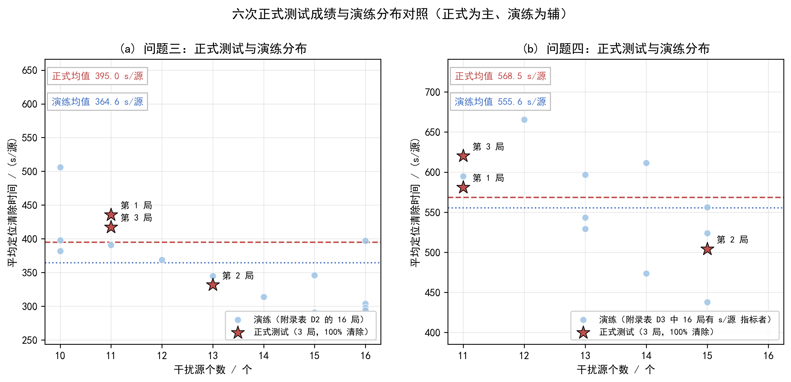

# 高教社杯 2026 · B 题：无线电干扰源的快速自动定位与清除

**河南赛区省级一等奖** · 团队数学建模作品

论文题目：**基于覆盖证书与顺路清除的干扰源全域保证检出与快速清除**。

[在线阅读论文（50 页）](https://dsegnr.github.io/papers/cumcm-2026-B-interference.pdf) · [仓库 PDF 原件](paper/cumcm-2026-B-interference.pdf) · [正式测试结果表](support/tables/tab_formal_runs.csv) · [AI 工具使用声明](support/AI%20工具使用详情.pdf)

## 做了什么

机器狗在圆形场地内巡行，通过测向观测定位干扰源，并在满足误差约束后清除。四个问题围绕定位不确定域、主动观测、全域搜索与定向源盲区展开。

| 问题 | 方法与实现 |
| --- | --- |
| 一：定位区域与覆盖圆 | 示向带交集、凸集直径、最小外接圆及几何反例分析 |
| 二：下一次观测位置 | 带保证接收约束的主动观测点设计，比较更新前后的定位不确定域 |
| 三：全向源搜索与清除 | 15 点建证集、覆盖终止判据，以及嵌入巡检路径的顺路清除策略 |
| 四：定向源搜索与清除 | 31 点位置—朝向检出覆盖证书，结合补给点、复测与尾段修复处理可定位性缺口 |

其中，Huber 加权最小二乘用于定位精化。覆盖证书在论文的场地、接收半径及方向性假设下提供搜索终止依据；检出覆盖和可定位性分别检查。



## 历史正式测试

以下数据来自竞赛提交时保存的六局结果，原始逐局表见 [tab_formal_runs.csv](support/tables/tab_formal_runs.csv)。时间单位为模拟器的虚拟秒，程序运行时间为另一项指标。

| 任务 | 局数 | 已清除 / 源数 | 平均定位清除时间（s/源） |
| --- | ---: | ---: | ---: |
| 问题三 | 3 | 35 / 35 | 395.0 |
| 问题四 | 3 | 37 / 37 | 568.5 |

表中的平均时间为三局各自 s/源 指标的算术平均。演练、对照与压力实验记录见 [tab_practice_summary.csv](support/tables/tab_practice_summary.csv)；最终配置样本与设计期实验的区别见原始[材料清单](support/00_材料清单.md)。

## 目录

```text
cumcm-2026/
├── paper/                  50 页正式提交论文
├── support/                原提交支撑材料的 103 个文件
│   ├── code/
│   │   ├── 01_冻结执行版/   正式测试主策略与问题四布局
│   │   ├── 02_核心算法代码/ 定位、覆盖证书、离线模型及审计
│   │   ├── 03_绘图与可视化/
│   │   └── 04_其他实验与过程/
│   ├── figures/            论文插图
│   ├── tables/             13 份 CSV 结果表
│   ├── latex/              论文与声明的 LaTeX 源码
│   └── AI 工具使用详情.pdf
├── reproduce.py            独立输出目录中的离线运行入口
├── verify_archive.py       原提交文件完整性检查
├── requirements.txt
├── SHA256SUMS
└── submission-hashes.json  原论文与支撑材料 ZIP 的内容哈希
```

代码保留设计过程中的不同布局和策略，包含未采用或表现较弱的方案。正式测试所用程序以 `support/code/01_冻结执行版/run6_robust.py` 和同目录布局文件为准。部分历史绘图与过程脚本依赖演练日志，需自行提供相应输入；已完成的结果图可直接阅读。

## 离线运行

在本目录下执行，建议 Python 3.12：

```sh
python -m pip install -r requirements.txt
python verify_archive.py
python reproduce.py q3-offline --runs 3
```

每次运行新建 `runs/<时间戳>-<任务>/`，其中 `stdout.log` 保存输出，`work/` 保存运行副本和生成结果。原始脚本和归档结果不会被覆盖。用 `--output <新目录>` 可自选输出位置，已有目录会被拒绝。

`q3-offline` 是设计期 **17 点布局**的离线模型示例，并非正式策略 15 点布局，也不重现上述六局正式测试成绩。

其他任务：

```sh
python reproduce.py q1-q2
python reproduce.py q3-certificate
python reproduce.py q4-detection
python reproduce.py q4-localization
```

覆盖证书求解和细网格审计比三局离线示例耗时更多。绘图脚本使用中文字体，环境中应安装黑体、微软雅黑或为运行副本配置可用字体。

发布时的验证环境：Python 3.12、NumPy 2.4.4、Matplotlib 3.10.8。`q1-q2` 数值实验与绘图、`q3-offline --runs 3` 均运行成功；历史正式成绩仍以上方原结果表为准。

## 官方模拟器与论文源码

正式主策略通过 `http://127.0.0.1:2026` 与官方模拟器通信，需要设置 `CUMCM_ROBOT_ID`。模拟器、账号、在线测试服务和个人行为日志不随本仓库提供。相关资料请从[全国大学生数学建模竞赛官网](https://www.mcm.edu.cn/)获取；竞赛服务能否继续使用以主办方安排为准。

LaTeX 编译方法见 [support/latex/说明.md](support/latex/说明.md)：将插图复制到编译目录的 `figures/`，使用 XeLaTeX 连编两遍。请在独立副本中编译。

## 使用与引用

程序采用 MIT 许可，论文、图表与其他学术材料的使用范围见 [RIGHTS.md](RIGHTS.md)。引用本作品时可注明：王佳豪、刘若岩，《基于覆盖证书与顺路清除的干扰源全域保证检出与快速清除》，2026 高教社杯全国大学生数学建模竞赛 B 题，以及本仓库链接。
